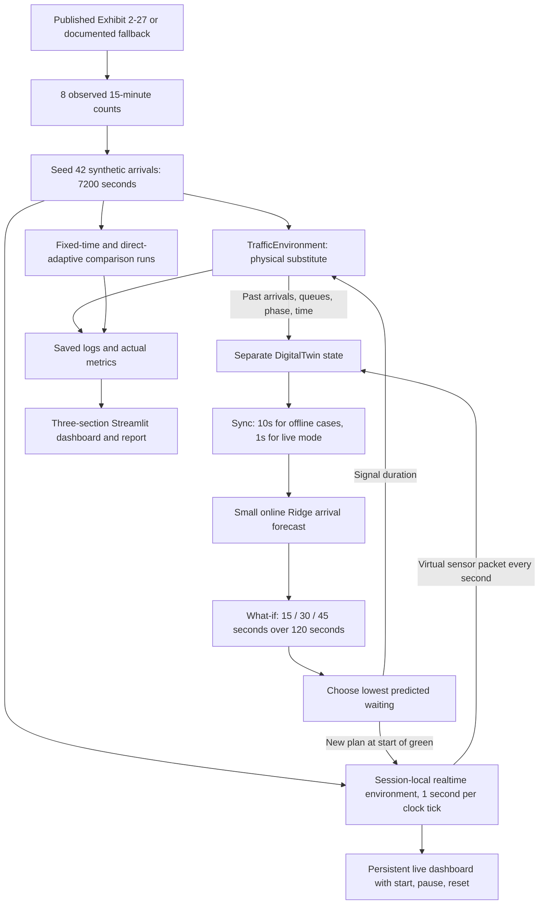

# Simple traffic Digital Twin

The environment owns the actual simulated queues and signal cycle. The Twin owns a separate snapshot received through immutable observations, plus an online forecast model. It never receives the full arrivals file or future rows. Its queue estimate is held between updates; the dashboard displays its age. Updates at green decision points provide current state before what-if prediction.

ML is deliberately small: Ridge regression learns next-10-second NS/EW rates from the total arrival rates in the previous three completed 10-second blocks. Alpha is 1, including intercept regularization. After six training samples, nonnegative predictions are blended 50/50 with the trailing mean (up to 60 seconds). Before training, only the available past mean is used; at time zero it is zero. Prediction holds this blended rate constant for 120 seconds. Ten-second observation updates drive online training; additional decision updates do not duplicate training samples.

The Twin copies its queues into temporary candidate models. Each candidate simulates valid alternating phases with yellow and all-red. Following the candidate's first green, all subsequent greens use 30 seconds. The minimum cumulative predicted end-of-second queue wins; ties prefer 30, then the shorter duration. The direct-adaptive policy only compares current queues, with a ±5 vehicle threshold, and has no forecasting model.

All runs start with empty queues and NS green. End-boundary log time 1 represents arrivals for input second 0; phase is the signal used during that second. A decision at boundary t affects the following second. The dashboard offers five independent cases after ML warm-up. Each case loads its own recorded queue snapshot, explains observation, synchronization, forecasting, and choice, then animates the selected green interval. It stops at the end of green with an arrival/service/backlog balance table. Moving to the next case requires a button press and resets visual identities and per-case counts. Yellow and all-red remain part of the full simulation and what-if model; the case presentation does not auto-play those transitions into another decision. Each waiting vehicle has one visible car identity; arrival and departure events are replayed in the simulator order without capping counts. Car size and spacing fit the longest queue in the excerpt; displayed queue and served counts come from the logs. Waiting sums queues after arrivals and service, so same-second service has zero queued waiting. Maximum queue is the maximum of either individual group; final backlog is the total remaining at 09:00, without a drain period. Predictions use fractional expected vehicles; the environment uses integer vehicles.

The realtime mode is a separate session-local `RealtimeSimulation` running the same environment and Twin. A periodic Streamlit fragment uses a monotonic clock to consume arrivals one second at a time; small timer jitter is accumulated, long suspensions are not fast-forwarded in full. Virtual sensor packets synchronize the separate Twin every second; only completed 10-second blocks create ML training samples. A persistent browser component receives current packets and draws exact queue/departure counts without restarting the car scene on each update. Each new green decision first passes through five visible explanation stages: queued vehicles, sensing, synchronization, what-if prediction, and selection. Each stage lasts at least two wall seconds with the simulation clock frozen; cars only move after selection. The clock then runs at approximately 1× through service and yellow/all-red, before the next visible cycle. Start/pause/reset act on the Python runtime. Changing to case mode pauses the live run. No database, worker service, browser build step, or extra runtime dependency is required.

The stored comparison experiment still uses the original 10-second sensing policy and writes full two-hour metrics. The realtime mode is tested against every second of that experiment: despite receiving more sensor updates, it makes the same decisions for the supplied arrival sequence. Pausing does not consume arrivals or train the model; resets create a new state and model.

This is an illustrative Twin of a simulated intersection, with offline and realtime simulation modes. The published data supplies entry totals only. Queues, phases, and virtual sensors come from the simulator. There is no field equipment, video, measured queue/delay, exact geometry, pedestrian model, or real signal control. The feedback loop demonstrates Digital Twin principles; it is not a live bidirectional twin of a real intersection. Synthetic timestamps and a simple forecast limit claims about real traffic performance.
