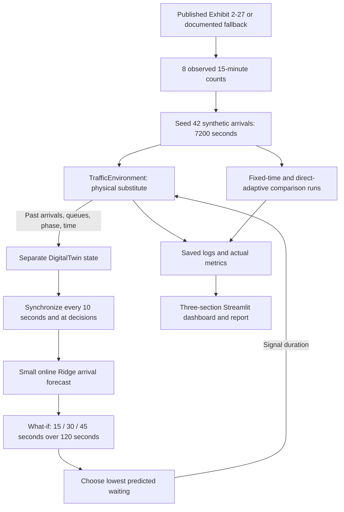

# Simple traffic Digital Twin

The environment owns the actual simulated queues and signal cycle. The Twin owns a separate snapshot received through immutable observations, plus an online forecast model. It never receives the full arrivals file or future rows. Its queue estimate is held between updates; the dashboard displays its age. Updates at green decision points provide current state before what-if prediction.

ML is deliberately small: Ridge regression learns next-10-second NS/EW rates from the total arrival rates in the previous three completed 10-second blocks. Alpha is 1, including intercept regularization. After six training samples, nonnegative predictions are blended 50/50 with the trailing mean (up to 60 seconds). Before training, only the available past mean is used; at time zero it is zero. Prediction holds this blended rate constant for 120 seconds. Ten-second observation updates drive online training; additional decision updates do not duplicate training samples.

The Twin copies its queues into temporary candidate models. Each candidate simulates valid alternating phases with yellow and all-red. Following the candidate's first green, all subsequent greens use 30 seconds. The minimum cumulative predicted end-of-second queue wins; ties prefer 30, then the shorter duration. The direct-adaptive policy only compares current queues, with a ±5 vehicle threshold, and has no forecasting model.

All runs start with empty queues and NS green. End-boundary log time 1 represents arrivals for input second 0; phase is the signal used during that second. A decision at boundary t affects the following second. The one-button dashboard replays five consecutive decisions after ML warm-up. It pauses the log at each decision boundary to explain observation, synchronization, forecasting, and choice, then animates the recorded seconds through green, yellow, and all-red. Car icons are capped illustrations; displayed counts come from the logs. Waiting sums queues after arrivals and service, so same-second service has zero queued waiting. Maximum queue is the maximum of either individual group; final backlog is the total remaining at 09:00, without a drain period. Predictions use fractional expected vehicles; the environment uses integer vehicles.

This is an offline illustrative Twin. The published data supplies entry totals only. Queues, phases, and virtual sensors come from the simulator. There is no field equipment, video, measured queue/delay, exact geometry, pedestrian model, or real signal control. The feedback loop demonstrates Digital Twin principles; it is not a live bidirectional twin of a real intersection. Synthetic timestamps and a simple forecast limit claims about real traffic performance.
